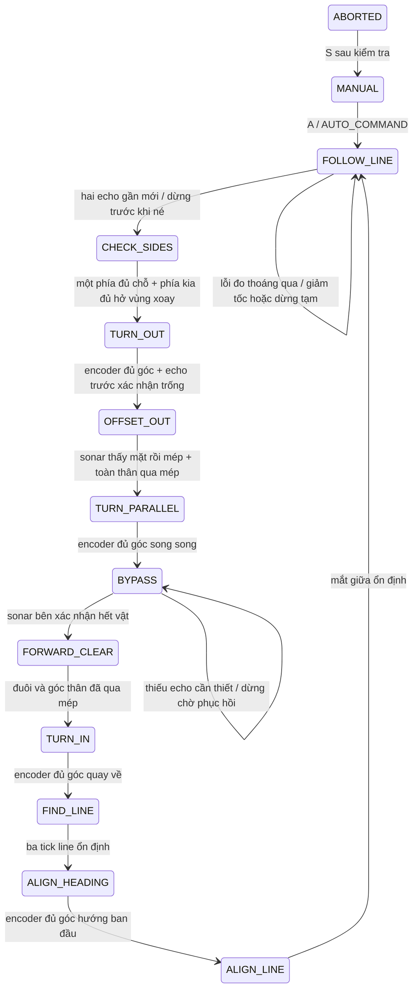

# Rà soát và tối ưu tổng thể xe ESP32

Giám sát encoder được cập nhật sau bản rà soát này: xem
[ENCODER_MONITOR.md](ENCODER_MONITOR.md). Watchdog hiện chạy sau lệnh điều khiển
mới, dùng target/actual PWM và chính sách riêng cho bánh trong cua/thao tác né.

Source đầy đủ: `esp32_line_3sensor_ultrasonic_avoid.ino`.
Giữ toàn bộ GPIO, L298N/LEDC Core 3.x, encoder D0, cơ khí 16 × 25 cm và khoảng
cách tâm bánh 13 cm. Giả định ba HC-SR04 hoạt động tốt; xử lý các bất thường
phép đo bằng phần mềm, không yêu cầu thay phần cứng.

## Lỗi logic đã sửa

1. RIGHT/LEFT có một lỗi đo từng làm FOLLOW_LINE gọi bộ chờ của AVOID rồi ABORT
   sau 1.5 giây. Nay lỗi bên chỉ làm chạy giảm tốc, tự phục hồi khi đủ echo thật.
2. Echo >190 cm từng bị đánh FAULT, dù timeout 12000 µs cho phép đo tới khoảng
   205.8 cm. Nay 190 cm là vùng quan tâm; echo trong timeout vẫn được giữ đúng
   khoảng cách thực và có REASON=OUTSIDE_USAGE_RANGE. Xung vượt timeout mới là
   PULSE_EXCEEDS_TIMEOUT. Không chèn khoảng cách giả vào bộ lọc.
3. ECHO còn HIGH tại timeout 12 ms chưa chứng minh chân kẹt: có thể là xung xa
   chưa kết thúc. Nay theo dõi qua các vòng loop; chỉ chốt ECHO_STUCK_HIGH nếu
   HIGH tiếp tục được quan sát quá 60 ms. HIGH trước trigger được chờ đo lại,
   không phát trigger chồng. Nếu rơi LOW, kết thúc chờ mà không chốt fault giả.
4. PWM tăng về phía âm từng dùng bước 45, trong khi phía dương dùng bước 12.
   Khi xoay hai bánh ngược chiều, chúng tăng tốc lệch nhau. Nay tăng/giảm theo
   độ lớn đối xứng, đảo chiều đi qua 0, giữ giới hạn và watchdog encoder.
5. Các nhánh dò line cộng PWM lớn gây điều chỉnh quá mức, và 000 dừng ngay cả
   khi mất ngắn. Nay dùng PD nhỏ, lọc error, giảm tốc cua và khôi phục có giới hạn.
6. Khi dịch thẳng, dữ liệu của phía đối diện không liên quan từng có thể gây
   chờ/timeout; lúc phục hồi cũng yêu cầu lại cả hai phía. Nay kiểm tra đúng
   các cảm biến cần cho pha; xoay vẫn cần cả hai bên do vùng quét thân xe.
7. Xác nhận line ở FIND_LINE từng chấp nhận ngay một tick. Nay cần ba tick từ
   cảm biến đã debounce rồi mới khôi phục hướng.
8. readStringUntil có thể chặn chờ ký tự. Nay parser giới hạn 16 byte/loop,
   nhận CR/LF hoặc kết thúc sau 20 ms không có byte mới; buffer lệnh 32 byte.

## Luồng và điều kiện



Mọi pha còn giữ giới hạn hành trình, thời gian, mất xung/kẹt bánh và va chạm.
ABORTED dừng và không tự khởi động lại. S rồi A là thao tác xác nhận của người
vận hành. Các dừng tạm không đổi mode nên có thể tự tiếp tục khi dữ liệu phục hồi.

### Dò line

| LCR | Điều khiển |
| --- | --- |
| 010 | error 0, đi thẳng, bù encoder khi hai PWM mục tiêu bằng nhau |
| 100 / 001 | error -2 / +2, giảm tốc cua, giới hạn chênh lệch PWM |
| 110 / 011 | error -1 / +1, chỉnh trái/phải nhẹ |
| 111 | giảm tốc, giảm dần error trước đó, không tự chọn nhánh giao lộ |
| 101 | giảm tốc, ưu tiên hướng lệch line gần nhất; chưa có hướng thì đi thẳng chậm |
| 000 | thử khôi phục theo hướng gần nhất tối đa 350 ms, trần 55 PWM |

Nếu chưa có hướng line trước đó, chỉ tiến chậm 80 ms rồi dừng. Nhiễu ngắn dưới
5 ms được debounce loại bỏ. Mất line dài dừng trong FOLLOW_LINE, không ABORT;
line xuất hiện ổn định ba tick sẽ tự chạy lại. Không bảo đảm chọn đúng nhánh
ở giao lộ chỉ với ba cảm biến digital.

PD dùng error đã lọc, đạo hàm đã làm mềm và chuẩn hóa theo thời gian gọi thực.
Hai bánh cùng độ lớn PWM mới dùng bù encoder; khi chỉnh line, bù không triệt
lệnh chênh lệch. Trần sonar UNKNOWN áp dụng cả PWM bù và các nhánh cua/khôi phục.

### NO_ECHO và lỗi đo

- NO_ECHO là UNKNOWN, không phải 200 cm hay lỗi phần cứng. FRONT có lịch sử xa
  hoặc chưa có echo được chạy giới hạn theo cấu hình; side UNKNOWN không chặn dò line.
- Cảnh báo gần 10 cm và ghi nhớ vùng cảnh báo 20 cm không bị timeout xóa. Chỉ
  echo mới xác nhận nhả ngưỡng 13 / 23 cm mới giải phóng chốt. EMA được đặt lại
  khi ba mẫu nhất quán xác nhận mức mới để tránh đuôi giá trị cũ giữ cảnh báo lâu.
- Một fault bên làm giảm trần mỗi bánh còn 60 PWM, không gọi timeout ABORT của né.
  Hai echo thật phục hồi sẽ tự trở về bình thường. Fault bên kéo dài vẫn giảm tốc.
- FRONT fault gây dừng thử lại 240 ms. Nếu chỉ thoáng qua rồi timeout bình thường,
  có thể thăm dò giới hạn nếu không có cảnh báo gần chưa giải quyết. Năm lỗi chưa
  phục hồi trở lên giữ dừng; đủ hai echo thật mới tự phục hồi. Không ABORT chỉ vì
  lỗi đo thoáng qua trong FOLLOW_LINE.
- ECHO_HIGH_BEFORE/PENDING không được dùng xác nhận trống khi né. Khi xác nhận
  kẹt thực sự, log ECHO_STUCK_HIGH. Xung ngắn bất thường: PULSE_TOO_SHORT; xung
  vượt timeout: PULSE_EXCEEDS_TIMEOUT; timeout thường: TIMEOUT.
- RAW hợp lệ mới quá gần vẫn dừng ngay, không đợi Median/EMA hay đủ mẫu phục hồi.

### Tránh vật cản

CHECK_SIDES không yêu cầu cả hai phía cùng >20 cm: phía chọn phải có khoảng
trống rẽ 20 cm, phía kia chỉ cần khoảng hở cho vùng xoay (4 cm + biên 1 cm).
Nếu phía kia UNKNOWN thì không chứng minh được vùng quét thân xe an toàn: dừng
đo lại, không đoán nó trống. Không dùng HELD/NO_ECHO để cấp quyền xoay.

TURN_OUT, TURN_PARALLEL, TURN_IN, ALIGN_HEADING, ALIGN_LINE cần đủ hở hai bên.
Các pha tịnh tiến cần phía trước trống và echo tin cậy của bên vật; phía đối diện UNKNOWN không gây deadlock. Bằng chứng va chạm bên đối diện vẫn dừng ngay.
Trong dừng chờ, giữ lại việc đã thấy vật; chỉ hủy xác nhận mép/đường trống có
thể đã lỗi thời. Phục hồi dựa trên các cảm biến thực sự liên quan, không yêu
cầu thêm cảm biến phía đối diện cho pha dịch thẳng.

Đường đi vẫn gồm bốn lần xoay danh định 90 độ. Dịch ngang không có đích cứng:
sonar xác nhận mặt → mép, rồi encoder đo phần bù thân 25 + 8 + 4 = 37 cm tính
từ mép; do đó tổng quãng dịch phụ thuộc vị trí mép thật. BYPASS đi thẳng bằng
encoder, không kéo xe vào vật. Sau mép cuối cũng cần đưa toàn thân qua rồi mới
quay về line. NO_ECHO không phải bằng chứng qua mép; nếu không đủ dữ liệu cho
thao tác né thì dừng chờ và có thể ABORT khi hết giới hạn, như yêu cầu an toàn.

## Serial

Mọi nhóm bắt đầu và kết thúc bằng đúng:

```text
--------------------------------------------------
```

Các helper dùng chung: printSeparator, beginLog/endLog, logMessage,
logStateChange, logSonarStatus và logControlAction. Nhóm gồm STATE CHANGE,
SONAR STATUS/SNAPSHOT, CONTROL, OBSTACLE, ABORTED, WAIT, STOP, COMMAND, READY.
State có FROM/TO/REASON; sonar có REASON; D có snapshot đầy đủ và dấu đóng nhóm.
Lệnh A/S/E/Z/F/B/L/R và số tốc độ được giữ, kể cả lệnh không kèm newline.
ABORTED không tự hồi bằng A; phải S rồi A. UNKNOWN COMMAND và lệnh quá dài cũng có nhóm.

CONTROL chỉ in khi hành động đổi, tối đa 2 lần/giây. D tối đa một bản/250 ms.
TX buffer UART 4096 byte được cấu hình trước Serial.begin để hấp thụ burst log;
không gọi flush hay chờ phát xong. API được đối chiếu với
[tài liệu UART chính thức Arduino ESP32](https://docs.espressif.com/projects/arduino-esp32/en/latest/api/serial.html).
Vẫn cần đo timing thực tế trên bo; buffer không bảo đảm không bao giờ chặn
nếu UART bị dồn log vượt tốc độ truyền.

## Thông số cần hiệu chỉnh

| Nhóm | Thông số chính |
| --- | --- |
| Cơ khí giữ nguyên | track 13 cm; thân 16 × 25 cm; hệ số quay trái/phải |
| Encoder còn tạm | PPR từng bánh 20; đường kính bánh 6.5 cm; cần đo thực tế |
| PD line | LINE_KP=18, LINE_KD=8, LINE_ERROR_ALPHA=0.4, correction tối đa 30 |
| Cua / tìm line | LINE_CORNER_PWM=60, LINE_RECOVERY_PWM=55, recovery=350 ms, grace=80 ms |
| Xác nhận line | debounce=5 ms, tái bắt line 3 tick |
| UNKNOWN | startup cho phép; trần startup=60, sau xa=65 PWM |
| Fault | DEGRADED_FOLLOW_PWM=60, FRONT_FAULT_PAUSE_MS=240, PERSISTENT_FAULT_SAMPLES=5 |
| Echo HIGH | ECHO_HIGH_FAULT_MS=60 trước khi xác nhận kẹt |
| Sonar | gap=60 ms, timeout=12000 µs, stale luồng=800 ms, hold=500 ms |
| Bộ lọc | median3, EMA=0.55, phục hồi 2 echo, rebase sau 3 mẫu nhất quán |
| Giới hạn né | chờ clearance 1.5 s, offset 80 cm/8 s, bypass 120 cm/12 s, tổng 45 s |

PWM không phải tốc độ vật lý. Các giới hạn phải hiệu chỉnh theo phản ứng cơ
khí/quãng phanh thực tế; không đổi thông số cơ khí chưa đo. Đĩa 20 xung với bánh
6.5 cm có độ phân giải khoảng 1.02 cm/xung; góc thực tế vẫn chịu lượng tử hóa,
quán tính và trượt bánh, chưa thể bảo đảm chính xác tuyệt đối từ mô phỏng.

## Kiểm thử và biên dịch

`tests/esp32_avoid/test.cpp` include chính sketch qua Arduino giả lập. Đã chạy
thành công g++ C++11 với -Wall -Wextra -pedantic và tất cả assertion.

| STT yêu cầu | Đã kiểm tra |
| --- | --- |
| 1–2 | Side NO_ECHO với FRONT xa; startup/far timeout kéo dài vẫn dò line giới hạn |
| 3–4 | FRONT 8 cm dừng ngay; timeout không xóa cảnh báo; echo mới xác nhận né |
| 5 | RIGHT fault rồi phục hồi; không dừng/ABORT toàn xe; tự hết giảm tốc |
| 6–9 | Sonar ổn định, LCR 010/100/001 và cả 110/011/111/101 |
| 10–11 | 000 ngắn khôi phục, 000 dài dừng, line trở lại tự chạy |
| 12 | Bốn chuỗi né hoàn chỉnh: hai bề rộng vật và hai phía né |
| 13 | Mất echo bên vật trong BYPASS không tạo mép; đối diện UNKNOWN không gây deadlock |
| 14 | Một encoder không có xung, lệch hai bánh, giữ watchdog và dừng |
| 15 | Capture Serial kiểm tra nhóm D, lệnh, state, lỗi, ABORT và READY có separator đầu/cuối |

Kiểm tra thêm: echo 190–205.8 cm, xung không hợp lệ, HIGH kết thúc sau timeout
không thành fault giả, HIGH kéo dài mới chốt lỗi, front fault thoáng qua/kéo dài,
PWM ramp hai chiều, trần PWM khi rẽ/bù, parser CR/LF/idle/quá dài, điều kiện phục
hồi cả chín pha và các kiểm thử bộ lọc trước đó.

Không tìm thấy arduino-cli trong PATH của phiên chạy; các vị trí SDK chuẩn
không truy cập được từ môi trường hiện tại. Chưa có kết quả biên dịch bằng
ESP32 toolchain, chưa nạp bo và chưa kiểm thử phần cứng. Không khẳng định các
mô phỏng logic chứng minh xe thật đã né thành công hay bảo đảm quãng phanh.
